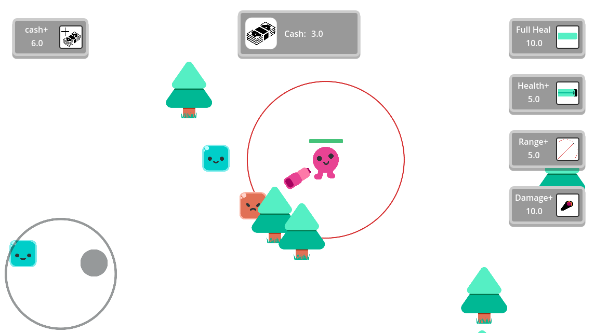

<div align="center">

# 🌸 Pink Circle

### A hand-drawn top-down arena shooter about a pink blob, a very small gun, and an unreasonable number of jelly enemies.

**Godot 4.4 · GDScript · 2D · Mobile-first · All artwork designed by the author**



</div>

---

## 🎮 About the game

**Pink Circle** is a fast, cheerful survival shooter set in a minimalist vector forest. You play as **Pinky**, a pink blob with a gun that is honestly too small for the job, while waves of cyan jelly creatures hunt you down from every direction.

There is nowhere to hide — only space to move, aim, and grow stronger. Every jelly you destroy drops **cash**, and cash is the whole point: spend it between the chaos on permanent upgrades and turn a tiny pistol into a screen-clearing problem solver. The longer you survive, the more the arena fills, and the more you have to decide whether the next upgrade is worth the risk.

It is simple to pick up, hard to put down, and built around one satisfying loop:

> **Move → survive → collect → upgrade → survive a little longer.**

### ✨ Features

- **Endless wave survival** — jelly enemies continuously spawn along a path around the arena and chase you relentlessly.
- **Automatic targeting** — Pinky's gun locks onto the nearest enemy in range and fires on its own, so movement is the real skill.
- **A living upgrade economy** — earn cash per kill and invest it in five upgrades:
  - 💰 **Cash+** — increases the value of every future kill
  - 💥 **Damage+** — multiplies bullet damage
  - 🎯 **Range+** — expands the gun's targeting radius
  - ❤️ **Health+** — raises maximum health
  - ✨ **Full Heal** — instantly restores Pinky to full health
- **Escalating prices** — every upgrade gets more expensive, forcing real choices instead of endless stacking.
- **Expressive hand-drawn characters** — Pinky and the jelly enemies are built from layered SVG parts with idle, walk, and hurt animations.
- **Custom explosion shader** — defeated jellies burst into a soft, procedural smoke puff driven by a Voronoi + gradient `canvas_item` shader.
- **Mobile-first controls** — a draggable on-screen virtual joystick works with both touch and mouse.
- **Game-over and retry flow** — the run ends, the score resets, and "Try Again" throws you straight back in.

<br />

## 🕹️ Controls

| Action | Input |
| --- | --- |
| Move Pinky | Drag the **on-screen joystick** (bottom-left) with mouse or touch |
| Shoot | **Automatic** — the gun targets and fires by itself |
| Buy upgrades | Click the upgrade cards on the right side of the screen |
| Buy Cash+ | Click the **Cash+** card in the top-left |

> **Tip:** the red circle around Pinky is the gun's targeting range. Range+ makes it larger — and lets the gun start shooting much earlier.

<br />

## 🚀 Run it in Godot

### Requirements

- **Godot 4.4** or newer (standard build — GDScript, no .NET required)
- Windows, Linux, or macOS

### Steps

1. Clone or download this repository.
2. Open **Godot 4.4+**.
3. Click **Import**, select the `project.godot` file in the repository root, and confirm.
4. Press **F5** (or the ▶ Play button) to run.

That's it — the project has no external dependencies, plugins, or network requirements.

> The game was designed mobile-first and originally exported for Android. It runs perfectly on desktop with the mouse acting as a touch pointer.

<br />

## 🏗️ Infrastructure & technical design

**Pink Circle** is a compact, dependency-free Godot 4.4 project that demonstrates a complete 2D game loop: spawning, path following, autonomous combat, economy, upgrades, UI, animation, shaders, and scene management.

### Engine & project configuration

| Layer | Implementation |
| --- | --- |
| **Engine** | Godot **4.4** (stable) |
| **Language** | **GDScript** throughout |
| **Renderer** | **Mobile** (`renderer/rendering_method="mobile"`) |
| **Texture import** | ETC2 / ASTC VRAM compression for mobile targets |
| **Display** | `canvas_items` stretch mode with `expand` aspect — the arena adapts to any screen ratio |
| **Main scene** | `scenes/start.tscn` → menu → `scenes/game.tscn` |
| **Platform target** | Android (original export preset); desktop-compatible |

### Gameplay architecture

- **`CharacterBody2D`** drives Pinky and the jelly enemies, with `move_and_slide()` for collision-aware movement.
- **`Area2D`** handles bullets, the gun's targeting radius, and Pinky's hurt box.
- **`Path2D` + `PathFollow2D`** distribute enemy spawns around the arena; a `Timer` triggers each spawn.
- **`AnimationPlayer`** drives layered SVG character animation (idle / walk / hurt).
- **`CanvasLayer`** separates the HUD and game-over overlay from the world.
- **Signals** connect the UI, player, gun, and game controller without tight coupling.
- **Static variables** hold run-wide state (cash, multiplier, bullet damage, gun range, health) so upgrades persist across scene nodes.
- **Custom shader** (`objects/smoke/explosion.gdshader`) produces a randomized, soft-edged explosion using Voronoi noise, an edge curve, and a color gradient.

### Combat & economy model

| System | Behaviour |
| --- | --- |
| Pinky health | 100 (scalable via Health+) |
| Bullet damage | 70 × damage multiplier |
| Bullet range | 700 px, speed 2000 px/s |
| Jelly health | 300 |
| Jelly speed | 250 px/s, constant chase |
| Cash per kill | `3 × cash multiplier` |
| Contact damage | 10 HP/sec per overlapping enemy |
| Cash+ cost | Starts at 6, increases ×1.5 per purchase |
| Other upgrades | Start at 5–10, double in price per purchase |

### Project structure

```
Pink Circle/
├── project.godot              # Engine, input, display and renderer configuration
├── icon.svg                   # Project icon (hand-designed)
├── scenes/                    # Menu, game controller, player, mob, gun, bullet, UI
├── characters/
│   ├── pinky/                 # Layered SVG player art + animation
│   └── jelly/                 # Layered SVG enemy art + animation
├── objects/
│   ├── gun/                   # Gun, bullet and range-circle art
│   ├── icons/                 # Upgrade and currency icons
│   ├── joystick/              # Virtual joystick art
│   ├── smoke/                 # Explosion scene + custom shader
│   └── tree/                  # Forest decoration
└── docs/
    └── screenshot.png         # The screenshot above
```

<br />

## 🎨 Art & authorship

Every visual asset in this game — Pinky, the jelly enemies, the gun, bullets, trees, joystick, upgrade icons, and the project icon — was **designed from scratch by Ali Moradpour Arani** as layered vector (SVG) artwork.

The explosion effect combines that hand-made art with a custom Godot shader for a soft, procedural burst.

<br />

## 📚 Development context

**Pink Circle** was created as a **university course project**, built to explore the full arc of a small game: player feel, enemy spawning, an upgrade economy, UI feedback, animation, shaders, and mobile deployment — all inside Godot 4.4.

It is shared here as a complete, runnable project for anyone who wants to play it, study it, or build on it.

<br />

<div align="center">

**Made with Godot 4.4 and a lot of pink.**

[← Back to Ali Moradpour Arani](https://github.com/AliMoradpourArani)

</div>
